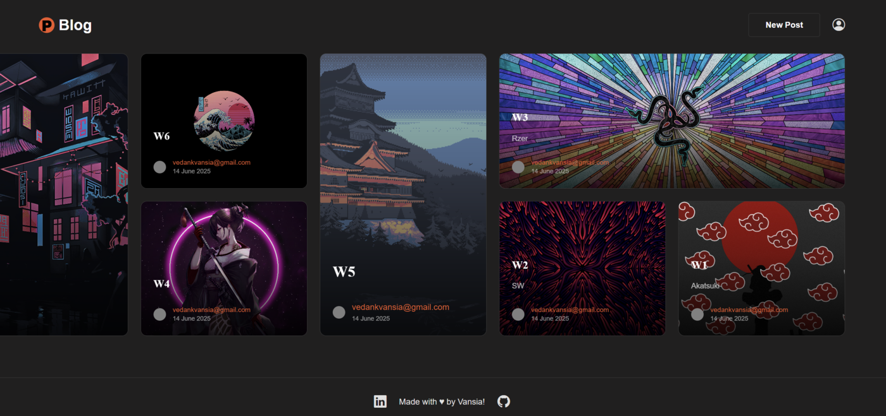

# PBlog

A full-featured blogging platform built with **Ruby on Rails 8**. PBlog features a dark-mode, bento-grid UI where authenticated users can create, edit, and delete Markdown-powered blog posts with optional cover images.



---

## ✨ Features

| Feature | Details |
|---|---|
| **User Authentication** | Devise-powered sign up / sign in / sign out, with **username** as the login key (not email) |
| **Full CRUD for Posts** | Create, read, update, and delete blog posts — owners only |
| **Markdown Support** | Post content is written in Markdown and rendered via `kramdown` + `kramdown-parser-gfm` |
| **Image Uploads** | Cover photo per post via Active Storage (local disk in dev, AWS S3 in production) |
| **User Avatars** | Avatar attachment on the `User` model (via Active Storage) |
| **Bento Grid Feed** | Dynamic, CSS grid-based index page where cards vary in size based on position |
| **Inline Markdown Editor** | Toolbar with **Bold**, *Italic*, and emoji shortcuts on the post form |
| **Authorization** | Only the post author can edit or delete their posts |
| **Flash Messages** | Styled success/danger flash notifications on every action |
| **Dark Theme** | Custom dark UI defined in `custom.css` with Bootstrap Icons |
| **Fade-in Animations** | Staggered card animations on the index page for a polished feel |
| **PWA Ready** | `manifest` and `service-worker` routes are scaffolded (currently disabled) |

---

## 🗂️ Project Structure

```
app/
├── controllers/
│   ├── application_controller.rb
│   └── posts_controller.rb         # Full CRUD with auth guards
├── models/
│   ├── user.rb                     # Devise + username login + avatar
│   └── post.rb                     # belongs_to :user, has_one_attached :photo
├── views/
│   ├── layouts/application.html.erb  # Header, footer, flash messages
│   ├── posts/
│   │   ├── index.html.erb          # Bento grid feed
│   │   ├── show.html.erb           # Full post view with hero image
│   │   ├── new.html.erb            # Create form with Markdown toolbar
│   │   └── edit.html.erb           # Edit form
│   └── devise/                     # Customised Devise views
├── assets/
│   └── stylesheets/
│       ├── application.css
│       └── custom.css              # Dark theme, bento grid, animations
config/
├── routes.rb                       # Authenticated root → posts#index
└── database.yml                    # SQLite (dev/test), multi-db (production)
db/
└── schema.rb                       # users, posts, active_storage_* tables
```

---

## ⚙️ Tech Stack

- **Framework:** Ruby on Rails `8.0.2`
- **Ruby:** `3.4.3`
- **Database:** SQLite 3 (development & test) / SQLite with multi-db layout (production via Fly.io)
- **Asset Pipeline:** Propshaft
- **JavaScript:** Importmap + Stimulus + Turbo (Hotwire)
- **Background Jobs / Cache / Cable:** Solid Queue / Solid Cache / Solid Cable
- **File Storage:** Active Storage — local disk (dev), AWS S3 (production)
- **Authentication:** Devise (username-based login)
- **Markdown:** kramdown + kramdown-parser-gfm
- **Icons:** Bootstrap Icons (CDN)
- **Deployment:** Fly.io via Kamal + Thruster + Docker

---

## 🚀 Getting Started

### Prerequisites

- Ruby `3.4.3` (manage with `rbenv` or `asdf` — see `.ruby-version`)
- Bundler `2.x`
- Node.js (for importmap / JS tooling)
- SQLite 3

### Installation

1. **Clone the repo**
   ```sh
   git clone https://github.com/itsmeved24/PBlog.git
   cd PBlog
   ```

2. **Install Ruby gems**
   ```sh
   bundle install
   ```

3. **Set up the database**
   ```sh
   rails db:create
   rails db:migrate
   ```

4. **(Optional) Seed sample data**
   ```sh
   rails db:seed
   ```

5. **Start the development server**
   ```sh
   rails server
   ```
   Open `http://localhost:3000` in your browser.

---

## 🗄️ Database Schema

### `users`
| Column | Type | Notes |
|---|---|---|
| `email` | string | Unique, required |
| `username` | string | Unique, used as login key |
| `encrypted_password` | string | Devise |
| `reset_password_token` | string | Devise |
| `remember_created_at` | datetime | Devise |

### `posts`
| Column | Type | Notes |
|---|---|---|
| `title` | string | |
| `content` | text | Markdown |
| `author` | string | Snapshot of `user.username` at creation |
| `is_template` | boolean | Reserved for future use |
| `user_id` | integer | Foreign key → `users` |

Active Storage tables (`active_storage_attachments`, `active_storage_blobs`, `active_storage_variant_records`) handle all file attachments.

---

## 🌐 Deployment (Fly.io)

The app ships with a production-ready Dockerfile and a `fly.toml` config. Continuous deployment is handled via **GitHub Actions** — any push to `main` triggers an automatic deploy.

```sh
# First-time setup
fly launch

# Manual deploy
fly deploy

# Open production Rails console
fly ssh console -C '/rails/bin/rails console'
```

The CI pipeline (`.github/workflows/ci.yml`) runs linting (RuboCop) and tests before every deploy.

---

## 🔮 Planned Enhancements

- [ ] User profile pages with bio, avatar display, and per-user post listing
- [ ] Rich-text editing via Action Text (Trix editor)
- [ ] Commenting system on posts
- [ ] Authorization policies via Pundit
- [ ] Post tags / categories and filtered feed
- [ ] Search functionality

---

## 👤 Author

Made with ♥ by **Vansia** — [LinkedIn](https://www.linkedin.com/in/vedank-vansia-73167b270) · [GitHub](https://github.com/itsmeved24)
